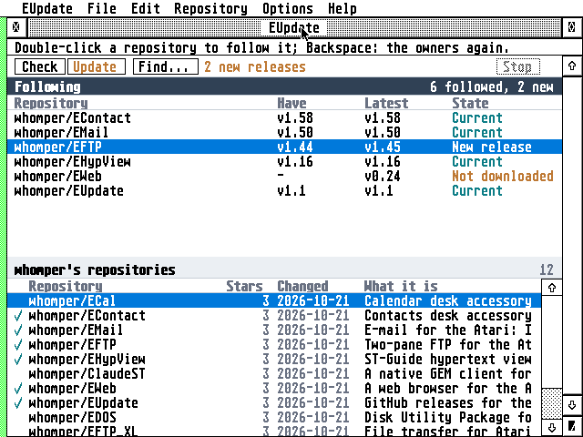

# EUpdate


The latest releases of GitHub repositories, straight to the Atari Falcon and TT: a GEM program that
finds repositories on GitHub, follows the ones you choose into folders of your choice, and updates
them with a click or on a schedule.

**Highlights**

- **The AERA programs, ready to follow** on its first start, each into `C:\AERA\`.
- **Find on GitHub** repositories by name, or owners and then their repositories.
- **Follow** a repository into a folder and see at a glance whether you are current.
- **Update** one, several or all with a click, or on a schedule.
- **Every file where it belongs:** zips unpacked, accessories to `C:\`, 8+3 names, safe writes.
- **TLS on the Atari itself**, the handshake on the Falcon's DSP; no gateway.
- **A GitHub token** is optional and kept encrypted; it goes only to GitHub's API.
- **Light:** about 250 KB, and 140 KB of `TLS.OVL` loaded when it first talks to GitHub.



## Getting started

Download the **[latest release](https://github.com/whomper/EUpdate/releases/latest)**, file by file
or all together in the zip:

| File | What it is |
|---|---|
| `EUPDATE.PRG` | the program (68030) |
| `TLS.OVL` | its TLS, the AERA family's: needed to reach GitHub |
| `CACERT.PEM`, `ROOTS.DAT` | the root certificates |
| `EUPDATE.HYP` | the user guide; the Help key opens it |
| `DEFAULTS.INF` | what it follows on its first start: the AERA programs |
| `icons/` | the desktop icon (`EUPDNV.RSC`, renamed, under NVDI's own palette) |

1. Copy the files into a folder of their own; EUpdate keeps its settings there.
2. Load STinG (or run MiNT with MiNTnet).
3. Start EUpdate: **Check** (^R), then **Update** (^D). **Help** opens the guide.

**Needs:** a Falcon or TT; TOS 3 or 4, EmuTOS, MagiC or MiNT; 640×400 or larger; about 500 KB free
and room for the biggest download; STinG or MiNTnet. The guide has the tips: `FOLDR100.PRG` under
TOS, STinG's Delay, and a GitHub token for more than 60 questions an hour.

## How it reaches GitHub

```
Falcon, TT:  Atari (EUpdate, TLS 1.2, the DSP) ---TLS---> api.github.com
                                               ---TLS---> where GitHub sends the files
```

## Building

```sh
sudo apt install gcc-m68k-linux-gnu python3
make            # binary/eupdate.prg, tls.ovl, cacert.pem, roots.dat
make dist       # dist/eupdate-x.y.zip, as on the Releases page
```

More (tests, fuzzing, the help file, releases, how it talks to GitHub):
[docs/DEVELOPING.md](docs/DEVELOPING.md).

## Source

```
src/        the core: HTTP, JSON, GitHub's API, zips, updating
ui/         the GEM side: window, lists, dialogs, menus
common/     the code the AERA programs share (from AERA-Atari)
```

## Tests

`make test` runs the core on this computer; the rest is in [docs/DEVELOPING.md](docs/DEVELOPING.md).

## Licence

EUpdate is free software under the GNU General Public License, version 2 or (at your option) any
later version, WITHOUT ANY WARRANTY; see [COPYING](COPYING). Copyright (C) 2026 AERA | Erez Yaary.

The AERA name and logos are not covered by the GPL (see
[AERA-Atari](https://github.com/whomper/AERA-Atari#licence)). GitHub is a trademark of GitHub, Inc.;
EUpdate is not affiliated with it.

It includes, under their own licences (compatible with the GPL):

- [BearSSL](common/third_party/bearssl) by Thomas Pornin: MIT licence
  ([LICENSE.txt](common/third_party/bearssl/LICENSE.txt))
- `CACERT.PEM`, the root certificates, from Mozilla's CA list (Mozilla Public License 2.0)
- the icon's mark: the Git logo by Jason Long, under the
  [Creative Commons Attribution 3.0](https://creativecommons.org/licenses/by/3.0/) licence (CC BY 3.0)

---

Part of **AERA** for Atari: [ECal](https://github.com/whomper/ECal) · [EContact](https://github.com/whomper/EContact) · [EMail](https://github.com/whomper/EMail) · [EFTP](https://github.com/whomper/EFTP) · [EHypView](https://github.com/whomper/EHypView) · [ClaudeST](https://github.com/whomper/ClaudeST) · [EWeb](https://github.com/whomper/EWeb) · [EUpdate](https://github.com/whomper/EUpdate) · [EPDF](https://github.com/whomper/EPDF) · 8-bit: [EDOS](https://github.com/whomper/EDOS) · [EFTP_XL](https://github.com/whomper/EFTP_XL) · Gateway: [AERA-Gateway](https://github.com/whomper/AERA-Gateway)
